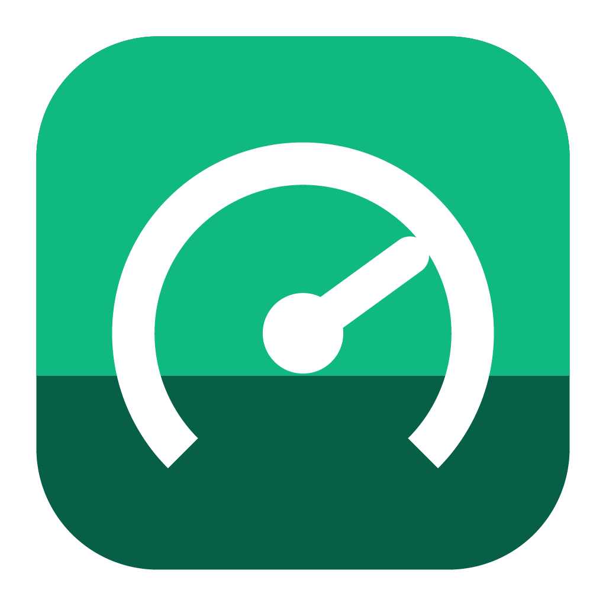

<p align="right"><a href="./README.md">EN</a> | <strong>简体中文</strong></p>

<div align="center">
  
  <h1>code-speed</h1>
  <p><em>你的编码 Agent 写得多快、用了多少、花了多少、额度还剩多少。<br>显示在菜单栏、系统托盘和终端里。数据来自本地日志，不会离开你的电脑。</em></p>
  <p>
    
    
    
    <a href="LICENSE"></a>
  </p>
</div>

```
▸ 86.4 tok/s · today 41.2M tok · $18.70 · avg 104 tok/s · Codex 5h 23% 7d 40%
```

## 功能

| | |
| --- | --- |
| **速度** | 所有 Agent 合计的实时输出速度（最近 3 秒的 tok/s，按 Agent 分色堆叠）及按 API 价格折算的每小时费用、每个会话的近期速度、今日平均和峰值，以及最近一次回复的速度和首 token 时间。macOS 上实时速度直接显示在菜单栏图标旁边。 |
| **用量与费用** | Token（输入、缓存读、缓存写、输出）、缓存命中率、请求数和按 API 价格折算的费用，可按**日、周、月、年、全部**查看，图表按小时、天或月展示（带纵轴和均值线），可**按应用、模型、项目**拆分，并与上一周期对比。点击柱子可把下方表格限定到那一天、那一小时或那个月；表格支持排序和筛选。 |
| **各模型速度** | 任意时段内，每个模型的输出速度：从慢的 10% 到快的 10% 画成一条带，标出中位数；以及首字时间的中位数和 P95，按速度排序。按天保存为很小的直方图，一年也只有几百 KB。 |
| **按推理强度** | 任意时段内，按每次请求的推理强度（Codex 的 `low` … `xhigh`、Claude Code 的 effort 等级）拆分用量、速度和费用，按 Agent 分开。 |
| **悬浮球** | 可选的小窗口，始终在最上层，所有桌面空间和全屏 App 上都在：实时速度、今日费用、按 Agent 颜色画的圆环，服务商出故障时还有一个小圆点。可以拖到任意位置，会记住。 |
| **服务状态** | Claude、OpenAI、GitHub、Cursor、xAI、Google Gemini、DeepSeek、Moonshot、MiniMax、Factory、Windsurf、Augment、Mistral、Groq、Fireworks、OpenRouter 的状态页快捷入口；有公开数据的，每 10 分钟读取当前状态和今日事件（默认开启，可在设置里关闭；访问不到的会在 10 分钟后重试，之后间隔逐步拉长，最长 6 小时）。默认跟随你在用的 Agent。 |
| **活跃度** | 53 周的日历，显示哪些天用过 Agent，以及当前连续天数、最长连续、活跃天数和最高的一天。 |
| **会话** | 今天或近 7 天的会话及其汇总；点开可查看每次请求的 token、速度、首 token 时间和费用（从该会话自己的日志重新读取）。 |
| **提醒** | 额度达到 80% / 95%、额度会在重置前用完、当日或当月费用达到预算的 80% / 100%，以及（需开启）新的速度纪录时发桌面通知；每个额度窗口、每天或每月只提醒一次。 |
| **预算、货币、导出** | 每日和每月预算，概览里显示进度；费用可按美元或其他 12 种货币显示（汇率自己设）；可按天 × 应用 × 模型导出 CSV 或 JSON 到“下载”目录。 |
| **系统** | 只运行一个实例（再次打开会显示面板）、开机自启（LaunchAgent、注册表 Run 键、XDG autostart）、全局快捷键打开面板、可选的每日更新检查（GitHub Releases，可原地安装更新：下载、按发布页 SHA-256 校验、替换、重启；也可以设为自动）、可选的每日价格表更新，以及应用内的自定义价格编辑器。 |
| **日志目录** | 可以为每个 Agent 添加更多日志目录，添加更多主目录（其他用户的、挂载的机器、备份，会像你自己的主目录一样查找），Windows 上还能读取 WSL 里的 Agent。修改某个 Agent 的目录后会重新读取一次它的历史。 |
| **订阅 vs API 价格** | 填写每个订阅的月费后，概览会显示近 30 天的用量按 API 价格折算是月费的多少倍。 |
| **上下文** | 每个活跃会话的上下文占用（已用 / 上限）。 |
| **额度** | Claude 的 5 小时和每周额度（通过 Claude Code 状态栏，需手动开启）、Codex 的 5 小时和每周额度、Grok Build 的额度，以及 Cursor 的每月包含用量（开启 Cursor 后），附重置时间和**消耗配速**：用得比时间进度快还是慢，以及按当前速度何时用完。 |

每个 Agent 在面板里都有固定的颜色。设置里可以选择语言（English、简体中文或跟随系统）、菜单栏显示内容（实时速度、速度 + 今日费用、今日费用或仅图标）、外观、读取哪些 Agent、它们的排列顺序，以及概览里隐藏哪些（仍计入总数）。仍在写入的回复会单独标出，因为它们的数字还可能变化。

### 支持的 Agent

| Agent | 数据来源 | 速度 | 用量与费用 | 上下文 | 额度 |
| --- | --- | --- | --- | --- | --- |
| Claude Code | `~/.claude/projects`（`CLAUDE_CONFIG_DIR`） | ✓ | ✓ | ✓ | 5 小时、每周（状态栏，需开启） |
| Codex | `~/.codex/sessions`、`archived_sessions`（含 `.jsonl.zst`）（`CODEX_HOME`）；快速（priority）请求取自 Codex 自己的 trace 日志 | ✓ | ✓ | ✓（使用它自己记录的窗口大小） | 5 小时、每周 |
| Gemini CLI | `~/.gemini/tmp`（`GEMINI_CLI_HOME`），JSONL 会话（v0.39+） | ✓ | ✓ | ✓ | — |
| Grok Build | `~/.grok/sessions`（`GROK_HOME`） | ✓ | ✓ | ✓ | 额度 |
| Kimi Code | `~/.kimi-code/sessions`（`KIMI_CODE_HOME`） | ✓ | ✓ | — | — |
| OpenCode | `~/.local/share/opencode/opencode.db`（`XDG_DATA_HOME`），只读 | ✓ | ✓ | ✓ | — |
| Pi | `~/.pi/agent/sessions`（`PI_CODING_AGENT_DIR`） | ✓ | ✓ | ✓ | — |
| Oh My Pi | `~/.omp/agent/sessions` | ✓ | ✓ | ✓ | — |
| DeepSeek Harness (dsh) | `~/.dsh/sessions`（`DSH_HOME`），zstd 压缩 | ✓ | ✓ | ✓ | — |
| Factory Droid | `~/.factory/sessions`（会话记录 + 计数器） | ✓ | ✓ | — | — |
| Antigravity | `~/.gemini/antigravity*/conversations/*.db`，只读 | ✓ | ✓ | — | — |
| Qoder、Qoder CLI | Qoder 的 `local.db`；`~/.qoder/projects` | ✓ | ✓ | ✓ | — |
| WorkBuddy、WorkBuddy AI | `~/.workbuddy/projects`、`~/.workbuddy-ai/projects` | ✓ | ✓ | — | — |
| ZCode | `~/.zcode/cli/db/db.sqlite`，只读 | ✓ | ✓ | — | — |
| Hermes Agent | `~/.hermes/logs`（`HERMES_HOME`） | ✓ | ✓ | — | — |
| OpenClaw | `~/.openclaw/agents/*/agent/openclaw-agent.sqlite` | ✓ | ✓ | — | — |
| 自己写（插件） | 你指定的位置，见 [docs/plugins.md](docs/plugins.md) | 有计时即可 | ✓ | 有记录即可 | 有上报即可 |
| Cursor *（联网，默认关闭）* | cursor.com，使用 Cursor 在本机保存的登录状态 | —（Cursor 不记录耗时） | ✓ | — | 每月 |

**Claude 额度。** Claude Code 只把订阅额度传给它的状态栏命令。在设置里开启“Claude 订阅额度”（或运行 `code-speed claude-quota on`）后，code-speed 会成为这个命令：记录额度后再运行你原来的状态栏，所以你在 Claude Code 里看到的内容不变；关闭时会恢复你原来的状态栏。它只修改 Claude Code `settings.json` 里的 `statusLine` 并保留备份，每次回复耗时 20–40 毫秒。Claude Desktop 不会运行状态栏，所以只统计 CLI 的使用。

暂不读取 Gemini CLI 旧版（v0.38 及以前）的整文件会话。Cursor 不在本地记录 token 用量：在设置里开启后，code-speed 会使用 Cursor 应用已有的登录状态，向 cursor.com 获取你的用量。

## 安装

macOS 或 Linux 一行安装：

```sh
curl -fsSL https://raw.githubusercontent.com/daemonx666/code-speed/main/install.sh | sh
```

它会按你的系统和芯片选择对应版本（macOS：一个通用版同时支持 Apple 芯片和 Intel；Linux：通过包管理器装 `.deb` 或 `.rpm`，否则把程序放到 `~/.local/bin`，没有桌面环境时装终端版），用发布页的 `SHA256SUMS` 及其签名校验每个下载，然后安装。加 `-s -- --cli` 只装终端版，`--version v0.8.0` 装指定版本，`--uninstall` 卸载（`--purge` 同时删除设置和历史）。

用包管理器安装：

```sh
# macOS（Homebrew；Homebrew 7 起要先信任第三方 tap 才会加载它的 cask）
brew tap daemonx666/tap
brew trust daemonx666/tap
brew install --cask daemonx666/tap/code-speed

# Windows（Scoop）
scoop bucket add code-speed https://github.com/daemonx666/scoop-bucket
scoop install code-speed
```

或者从 [Releases](https://github.com/daemonx666/code-speed/releases) 下载：

| 系统 | 文件 | |
| --- | --- | --- |
| macOS 13+（Apple 芯片和 Intel） | `code-speed-<ver>-macos-universal.dmg` | 拖进“应用程序”。 |
| Windows 10/11（x64、arm64） | `code-speed-<ver>-windows-<arch>-setup.exe` | 装到当前用户目录，不需要管理员权限。另有 `-portable.zip` 免安装版。 |
| Debian、Ubuntu 22.04+ | `code-speed_<ver>_<arch>.deb` | `sudo apt install ./code-speed_*.deb` |
| Fedora、openSUSE | `code-speed-<ver>-1.<arch>.rpm` | `sudo dnf install ./code-speed-*.rpm` |
| 其他 Linux | `code-speed-<ver>-linux-<arch>.tar.gz` | 需要 GTK 3 和 WebKitGTK 4.1。 |
| 仅终端，任意系统 | `code-speed-cli-<ver>-<os>-<arch>` | 单个静态二进制，不含 WebView。 |

> **macOS：** 目前是 ad-hoc 签名，未经公证。第一次打开时右键点 App →“打开”，或者运行
> `xattr -dr com.apple.quarantine /Applications/code-speed.app`。
>
> **Windows：** Windows 10 和 11 自带 WebView2。安装包未签名，SmartScreen 可能拦截，点“更多信息”→“仍要运行”即可。

## 使用

打开 App 后，菜单栏（macOS）或系统托盘（Windows、Linux）会出现一个图标。左键打开面板，右键可以退出。

同一个二进制也是命令行工具：

```
code-speed            打开 App（纯终端版会运行 watch）
code-speed watch      单行实时刷新，每秒一次
code-speed today      今日用量和费用，按 Agent、模型拆分
code-speed week       最近 7 天
code-speed stats [day|week|month|year|all] [agent|model|project]
code-speed claude-quota on|off|status
code-speed quota      订阅额度和重置时间
code-speed json       以上全部，输出为一个 JSON 快照
```

```
$ code-speed today
Today (2026-11-14): 41.2M tokens · $18.70 · 352 requests · avg 104 tok/s
Last reply: claude-sonnet-5-5, 812 tokens at 97.3 tok/s (Claude Code)

By agent
               Requests  Input  Cached  Output   Avg speed    Cost
  Claude Code       301  37.9M   35.8M    264K   109 tok/s  $15.92
        Codex        51  3.03M   2.41M   41.5K  71.8 tok/s   $2.78
```

如果你的 Agent 把文件放在别处，`CLAUDE_CONFIG_DIR` 和 `CODEX_HOME` 环境变量都会生效。

## 插件、自定义价格与 API Key

- **插件。** 不用重新编译就能接入 code-speed 还不认识的 Agent：在插件目录放一个带 `plugin.json` 的文件夹。`jsonl` 插件只需声明哪些日志行是回复、模型/时间/token 在哪个字段（不写代码）；`command` 插件是任意语言写的程序，输出 JSON 行（回复、额度、会话），因为会运行代码，默认关闭、需在设置里开启。见 [docs/plugins.md](docs/plugins.md) 和 [examples/plugins](examples/plugins)；`code-speed plugin test <目录>` 可以检查插件。
- **自定义价格。** `custom-prices.json` 可新增或覆盖模型价格（API 中转站自己的模型名、私有部署），也可以按 Agent 或 provider 设置折扣倍率（例如中转站按官方价 30% 收费）。`code-speed prices` 查看当前状态。
- **API Key、中转站与云平台。** Claude Code 和 Codex 无论用订阅、API Key、中转站（`ANTHROPIC_BASE_URL`、Codex 的 `model_provider`）、Bedrock 还是 Vertex，写出的日志格式都一样，所以速度、用量、上下文和费用照常统计；中转站自定义的模型名需要在自定义价格里补上价格。

## 数字是怎么算的

code-speed 不代理 Agent 的 API 请求，只读取 Agent 自己写的日志，边写边读。

- **单次回复速度** = 输出 token ÷（用量写入时间 − 请求发出时间）。包含首 token 等待时间，所以是端到端速度，不是纯解码速度。超过 15 分钟的回复不计入速度；不足 0.5 秒的按 0.5 秒算。
- **实时速度**：把每次回复的输出 token 均匀摊到它的时间区间上，再对最近 3 秒求和。正在生成的回复还没有写出用量，这部分按该 Agent 的近期速度*估算*（没有就用同模型的，再没有就用同类 Agent 的），并标记为“估算”。
- **去重**：恢复（resume）和分叉（fork）的会话会把历史复制到新文件里，每次回复只算一次。
- **费用**按 API 公开价折算，和你订阅实际怎么计费无关。查不到价格的模型记为“未定价”，不会当成 $0。价格来自内置价格表（202 个模型、13 家厂商），支持长上下文阶梯价、fast 模式、按日期变价和错峰价。
- **Codex 额度**读自 Codex 每次回复后写进日志的 rate limits，所以跟你最后一次 Codex 请求一样新。

额度配速沿用 CodexBar（MIT）的算法：预期用量是窗口已过去的时间占比，超出 2 个百分点以上即为“比时间进度快”。测量规则和价格表来自 [Agent Speed](https://github.com/zoefix/agent-speed) 的规格文档（MIT），价格代码原样通过了它的 95 个测试用例。

## 与 CodexBar 的费用对比

用同样 7 天的真实日志、两者都只读本地数据对比：token 数一致，费用差异来自计费规则不同。

| | code-speed | CodexBar |
| --- | --- | --- |
| Claude Haiku 5.5 输入超过 10 万 | 整次回复按长上下文价格（Anthropic：每百万 $0.50 / $2.50） | 按短上下文价格 |
| Codex 快速（priority）请求 | 按快速价格，依据线程的 service tier 和 Codex 的 trace 日志 | 同样，另外还有它以前扫描 trace 日志时记住的 priority 轮次（trace 日志只保留约一天） |
| GPT-6.1 Terra 快速模式 | 价格表里的快速价格 | 标准价格 |
| Codex 归档会话（`.jsonl.zst`） | 读取 | 只统计压缩前已读过的 |

## 资源占用

在 M 系列 Mac 上用 7 个月的真实日志实测（3.8 GB，约 4 万次回复）：

| | |
| --- | --- |
| macOS 安装包（universal） | 14 MB `.dmg` |
| 纯终端二进制 | 11 MB |
| 首次启动（完整读取一次历史） | 后台约 10 秒，面板显示进度 |
| 之后启动（已保存历史，只读新增日志） | 约 0.1 秒，约 37 MB |
| 常驻 | 约 16 MB（终端版）、约 60 MB（App，另有系统 WebView 自己的进程）；CPU 约 0% |
| 历史文件 | 7 个月约 85 KB |

二进制里约 6 MB 是 OpenCode 和 Cursor 需要的纯 Go SQLite 读取库，约 2 MB 是 Cursor 用到的 HTTPS 客户端。

所有系统都用同一种轮询方式，不依赖文件系统事件：每秒检查最近 15 分钟内有改动的少数文件，每 10 秒扫描一次新文件，每 5 秒读取一次数据库。

## 隐私

code-speed 只读取 Agent 的日志和数据库，从不写入（数据库以只读方式打开）。除非你开启了 Cursor（会访问 cursor.com）、更新检查（会访问 api.github.com）、每日价格表更新（会访问 raw.githubusercontent.com 或 jsDelivr 镜像，获取 Agent Speed 公开的价格表）、服务状态检查（默认开启，会访问各服务商公开的状态页，可在设置里关闭）或安装更新（会访问 github.com），它不发任何网络请求。价格表请求对所有人都是同一个文件的普通 GET；只有通过自身测试、且比内置版本更新的价格表才会被采用。

它只写自己的目录（`~/Library/Application Support/code-speed`、`%AppData%\code-speed`、`~/.config/code-speed`；可用 `CODE_SPEED_HOME` 改位置）：

| 文件 | 内容 |
| --- | --- |
| `settings.json` | 你的设置 |
| `history.json` | 已结束日期的按天汇总（每个 Agent、模型、项目、小时的 token、费用和请求数）；不含任何提示词或回复内容 |
| `alerts.json` | 已经发过的提醒，避免重启后重复提醒 |
| `prices/` | 仅在开启价格表更新时：下载的价格表和上次检查的时间 |
| `quota/` | 仅在开启 Claude 额度时：Claude Code 最近报告的额度、你原来的状态栏，以及 Claude Code `settings.json` 的备份 |

桌面 App 用的系统 WebView 会自己保存一个很小的站点数据目录，所有基于 WebView 的 App 都会这样（Wails 没有提供关闭它的选项）：

| 系统 | 目录 | |
| --- | --- | --- |
| macOS | `~/Library/WebKit/io.github.daemonx666.code-speed`、`~/Library/Caches/io.github.daemonx666.code-speed` | 不到 1 MB |
| Windows | `%APPDATA%\code-speed.exe`（WebView2 的用户数据） | 卸载时会删除 |
| Linux | WebKitGTK 在 `~/.local/share` 和 `~/.cache` 下的目录 | |

## 从源码构建

需要 Go 1.26+。

```
make cli            # 纯终端二进制，不需要 cgo
make build          # 本机的桌面 App
make test           # 两种构建的 gofmt、vet 和测试
make dev-ui         # 在浏览器里打开面板 http://127.0.0.1:47811，开发界面用
make dmg            # macOS universal .app、.dmg 和 .zip
make release-cli    # 6 个系统/架构的终端二进制
make release-windows  # Windows .exe（任何系统都能交叉编译）；装了 makensis 时还会生成 setup.exe
make release-linux  # Linux 构建、.deb、.rpm 和 .tar.gz（需在 Linux 上执行）
```

Linux 需要 WebView 头文件：`sudo apt install libgtk-3-dev libwebkit2gtk-4.1-dev`（Debian、Ubuntu）或 `sudo dnf install gtk3-devel webkit2gtk4.1-devel`（Fedora）。

推送 `v*` 标签会触发 [`.github/workflows/release.yml`](.github/workflows/release.yml)，在 GitHub 的 runner 上构建以上全部安装包，连同 `SHA256SUMS` 一起发布。

## 技术架构

一个 Go 二进制。每个 Agent 是一个自注册的包，新增一个 Agent 只需写一个解析器（数据库或 API 则写一个轮询器）和对应测试。桌面外壳用 [Wails v3](https://github.com/wailsapp/wails)，调用系统自带的 WebView（macOS 是 WebKit，Windows 是 WebView2，Linux 是 WebKitGTK），不打包浏览器内核。面板是不用框架的纯 HTML、CSS、JS，只读一个 JSON 接口。加上 `nogui` 构建标签就去掉 WebView，得到纯 Go 的终端二进制。整体结构参考了 [magpie](https://github.com/yetone/magpie)。

```
main.go, gui_on.go, gui_off.go   入口；构建标签决定是 App 还是终端版
internal/source     Agent 注册表、日志增量读取、Claude Code 和 Codex 解析器
internal/source/*   每个 Agent 一个包（gemini、grok、kimi、opencode、pi、cursor）
internal/engine     实时速度、各维度的按天用量、时间段统计、历史文件
internal/pricing    价格表（prices.json）和计费规则
internal/monitor    读取历史，之后持续跟踪日志、轮询数据库
internal/service    设置和正在运行的 monitor
internal/gui        托盘、面板窗口、悬浮球、面板页面（assets/：中英文）
internal/status     各服务商公开的状态页
internal/update     新版本检查和原地安装
internal/cli        命令和格式化
build/              图标、Info.plist、.desktop、nfpm、NSIS 安装脚本、devui
packaging/          Homebrew cask、Scoop、winget 和 AUR 清单（render.sh）
```

## 路线图

- 在一个视图里合并多台机器的用量，借助你已经在同步的文件夹（不需要服务器）。
- macOS 的 Developer ID 签名和公证；签名的 Windows 安装包。
- 更多 Agent：Copilot CLI、Qwen Code、Cline、Goose。

## 致谢

- [Agent Speed](https://github.com/zoefix/agent-speed)：测量规格、价格表和测试数据（MIT）。
- [magpie](https://github.com/yetone/magpie)：本项目沿用的 Go + Wails v3 架构。
- [Token Monitor](https://github.com/Javis603/token-monitor) 和 [CodexBar](https://github.com/steipete/CodexBar)：参考了它们的用量和额度功能。

详见 [THIRD_PARTY_NOTICES.md](THIRD_PARTY_NOTICES.md)。

## 许可证

[MIT](LICENSE)
